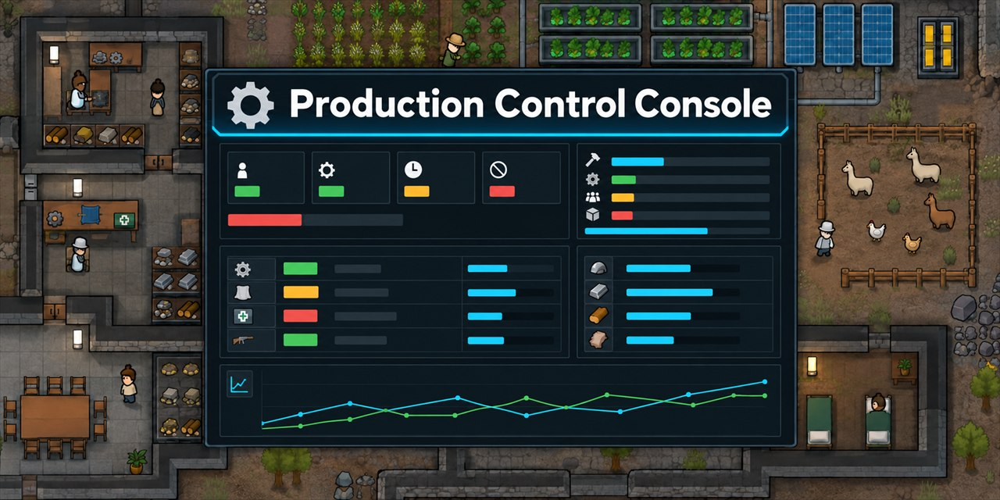

# Production Control Console

*[Описание](README.md)*

**Управление производством колонии в одном окне.**

`Версия 0.2.6` · `RimWorld 1.6 и 1.7` · требуется [RimUI Framework](https://steamcommunity.com/sharedfiles/filedetails/?id=3763759074)

# История изменений

## 0.2

- **RimWorld 1.7.** Один мод для 1.6 и 1.7: каждая версия игры загружает свою сборку. Требуется RimUI Framework 0.4.0 или новее.
- **Варианты рецепта.** Рецепты с большим выходом — например, простая еда ×4 — стоят в мастере отдельной строкой, а в карточке задачи вариант выбирается из списка. Количество считается целыми циклами: заказ на 50 при ×4 станет 52, и поле покажет это сразу.
- **На пол у верстака.** Мастер кладёт готовое рядом с верстаком и сразу берётся за следующее, а на склад его относят другие колонисты.
- **Пакет задач.** В мастере можно отметить несколько продуктов: общие настройки задаются один раз, режим и количество у каждого свои, на выходе — отдельные задачи.
- **По образцу.** Новая задача с настройками уже существующей — остаётся выбрать продукт.
- **Удаление задачи — с подтверждением.**
- **Исправлено.** Выбор рецепта зависел от языка игры, и в английской версии вариант ×4 не использовался никогда. Запас не учитывал продукт в руках колонистов и мог запустить лишний цикл, пока готовое несли на склад. После смены языка в игре каталог работал со старыми данными, и запас читался как ноль. Окно консоли теряло захват при перетаскивании, если увести курсор за рамку.
- **Справка.** Новые разделы о вариантах рецепта, пакете задач и кнопках карточки. Исправлено описание верстаков: один верстак может работать на несколько задач.

## 0.1

- **Производство.** Задачи создаются пошаговым мастером: продукт, количество, источники сырья, разрешённые материалы, верстаки, исполнители и склад для готового. Три режима — сделать заданное количество, поддерживать запас, работать бесконечно; для операций без продукта — число выполнений.
- **Несколько верстаков на одну задачу.** Они работают на общий счёт и видят единый запас, поэтому не производят лишнее независимо друг от друга. Один верстак может работать на несколько задач: их задания стоят у него в очереди по приоритету.
- **Садоводство.** Поля, зоны выращивания и гидропоника из одной вкладки: повтор одной культуры, очередь культур с полным циклом поля, запрет посева, лечение болезни, копирование плана на другие участки.
- **Животноводство.** Приручение, охота и забой по видам. Лимиты стада по полу и возрасту в одной таблице, область или загон и уровень лечения для новых прирученных, приоритет забоя, пометки на конкретных животных в таблицах прирученных и диких.
- **Обзор.** Состояние производства, загрузка верстаков, задачи, требующие внимания, с причиной словами, ближайшие завершения и выпуск за семь игровых дней.
- **Верстаки, колонисты и склады** — отдельными вкладками, с переходом к связанным объектам и галочкой «использовать» у каждого объекта.
- **Сводка по складам.** Что лежит, сколько требуется задачам и каков баланс.
- **Понятные причины остановки.** Не хватает сырья, нет верстака, некому работать, не исследовано, склад исчез или выключен — причина написана словами там же, где видна остановка.
- **Справка внутри игры.** Сорок подразделов простым языком: что делает каждый блок, когда пригодится и чего мод не делает. Кнопка «Показать в консоли» открывает нужную вкладку и подсвечивает блок, о котором идёт речь.
- **Настройки.** Частота проверок по трём разделам отдельно, стартовые значения новой задачи и галочки разделов — чтобы не перебивать одно и то же в каждом заказе.
- **Совместимость.** Каталог строится по данным самой игры, поэтому рецепты и верстаки из других модов подхватываются сами. Harmony не используется. Мод можно добавить в существующее сохранение.
